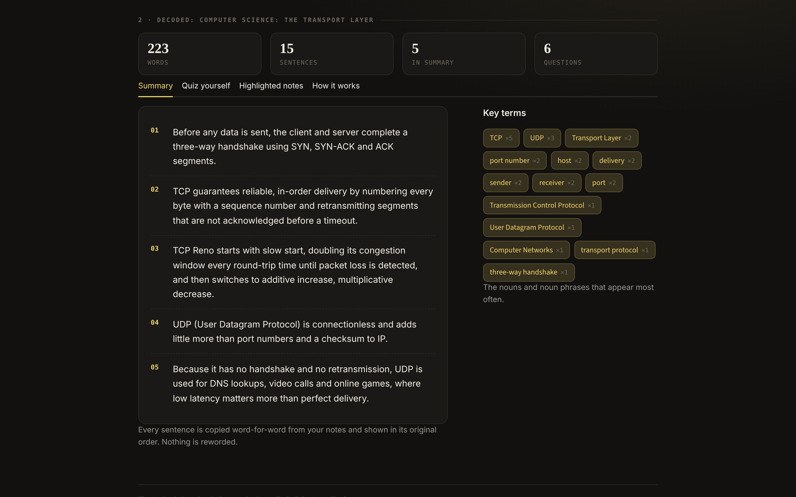
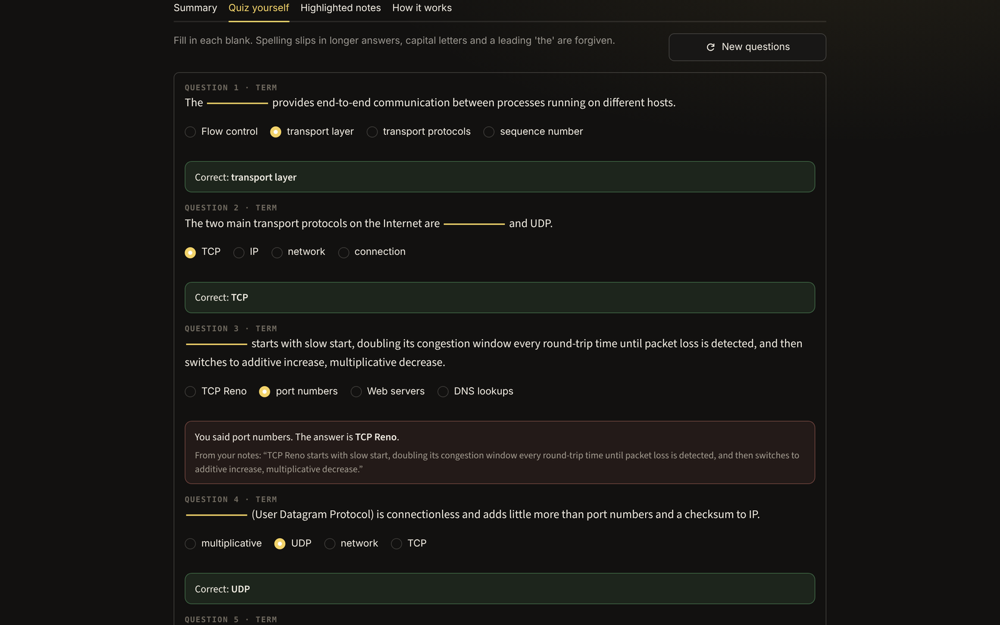

# The Academic Decoder

[](https://github.com/ChachraArnav/TheAcademicDecoder/actions/workflows/ci.yml)

Paste or upload your study notes. The Academic Decoder picks out the sentences that carry the most weight, lists the key terms, and turns your own sentences into fill-in-the-blank questions so you can check what you actually remember.

It uses classic natural language processing (spaCy) rather than a generative AI model. Every summary sentence and every question comes word-for-word from your notes, so nothing is made up, it runs free, and your notes never leave the machine running it.



## What it does

| | |
| --- | --- |
| **Summary** | The highest-scoring sentences from your notes, in their original order |
| **Key terms** | The nouns and noun phrases you use most (`carbon dioxide`, `Calvin cycle`) |
| **Quiz** | Fill-in-the-blank questions, multiple-choice where the notes have enough similar terms, with forgiving answer checking |
| **Highlighted notes** | Your full notes with the summary sentences highlighted and every sentence's score shown |
| **Study report** | Download the summary, questions and your results as Markdown |

Input can be pasted text or a `.txt`, `.md`, `.pdf` or `.docx` file.



## How it works

**Summary: word frequency (Luhn, 1958).** Words a set of notes uses most are probably what it is about.

1. spaCy reduces every word to its dictionary form (`reactions` → `reaction`) and drops stop words (`the`, `is`).
2. Each word's count is divided by the highest count, so the most frequent word scores 1.
3. A sentence scores the sum of its word scores. Headings and fragments under five words are skipped.
4. The top sentences are kept, in the order they appear.

**Questions: blank out the key term.**

1. For each sentence, spaCy finds candidate answers: named entities (people, dates, places, organisations) and noun terms. A noun is kept together with the nouns in front of it, so the answer is `carbon dioxide`, not `dioxide`.
2. Each candidate is scored by how often its words appear in the notes, with a bonus for named entities. Candidates that appear twice in the same sentence are skipped because the second copy would give the answer away.
3. The best candidate in each sentence becomes the blank, and the strongest questions across the notes are kept, with no answer used twice.
4. Wrong options are other terms from the same notes and of the same kind (a person for a person, a date for a date). They are ranked by meaning similarity using spaCy's word vectors, so they are plausible, and any option already visible in the question is skipped.
5. Answers ignore capitals, punctuation, a leading "the" and a plural "s". A small typo is accepted only in answers of 8+ letters, so `plant` is not accepted for `planet`.

**Cleaning.** Text copied from PDFs and slides is repaired first: words hyphenated across lines are rejoined, wrapped lines are merged, bullets and page numbers are dropped, and headings stay separate.

## Project layout

```
app.py               Streamlit web app
decoder/
  text.py            read .txt / .md / .pdf / .docx and clean the text
  nlp.py             spaCy pipeline and shared helpers
  summarize.py       word-frequency summary and key terms
  quiz.py            question generation, options and answer checking
  report.py          Markdown study report
  cli.py             terminal version (python -m decoder)
samples/             two short sample notes for the demo
tests/               pytest suite
```

## Run it

```bash
python -m venv .venv
.venv\Scripts\activate          # Windows; use source .venv/bin/activate on macOS/Linux
pip install -r requirements.txt

streamlit run app.py            # web app
python -m decoder notes.pdf     # terminal version; omit the file to paste text
```

`requirements.txt` installs spaCy's `en_core_web_md` English model directly, so there is no separate download step.

Tests and lint:

```bash
pip install -r requirements-dev.txt
pytest
ruff check .
```

GitHub Actions runs both on every push.

## Limitations

- It selects sentences; it doesn't understand them. A key idea stated only once can be missed, and the summary is only as clear as the original sentences.
- spaCy's general English model sometimes mislabels technical terms, for example tagging an acronym as an organisation, which can produce an odd multiple-choice option.
- Questions test recall of wording, not deeper understanding.
- Scanned PDFs have no text layer and need OCR first.
- Works on English text only.

## Privacy

Notes are processed in memory and are not saved, logged or sent to any external service.

## History

The first version (October 2026) was a single terminal script using NLTK and spaCy. This version keeps the same idea, a frequency-based summary and quizzes built from named entities, and adds the web app, file uploads, whole-term answers, multiple-choice options, forgiving answer checking, tests and CI.
